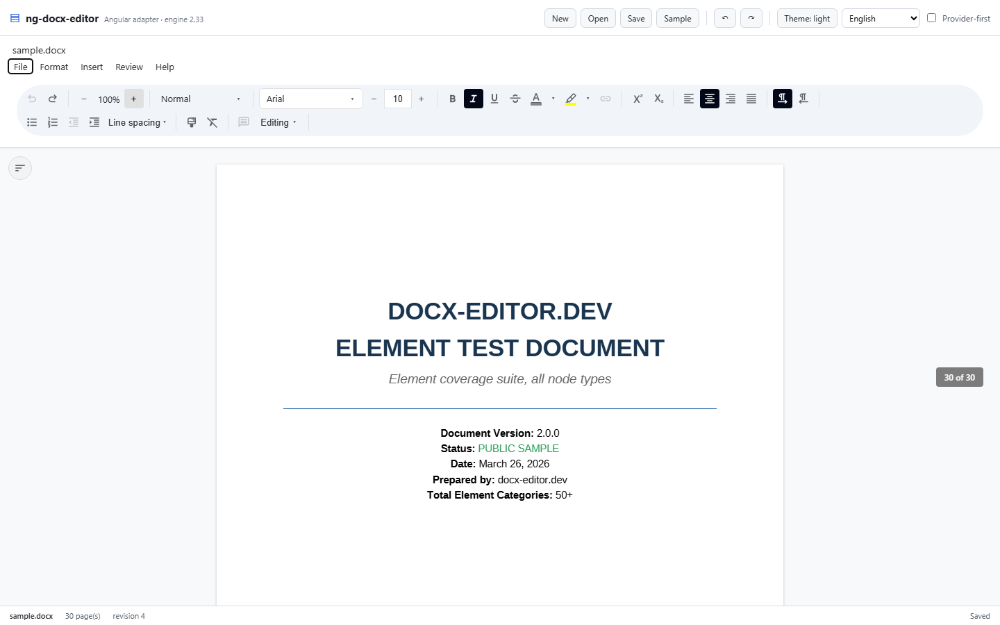

<div align="center">

# ng-docx-editor

**An Angular DOCX editor.** Word-faithful pages, a formatting bar, a menu bar and a headings
pane — driven by the same engine, the same chrome registry and the same stylesheet as
[docx-editor](https://github.com/eigenpal/docx-editor)'s React and Vue adapters.

[](https://angular.dev)
[](https://www.npmjs.com/package/@docx-editor.dev/core)
[](#license)

</div>



```html
<docx-editor [document]="bytes" title="Contract.docx" (change)="markDirty($event)" />
```

That is a complete editor: painted, paginated, editable pages; undo and redo; styles, fonts,
sizes, colours, alignment, lists, line spacing; File · Format · Insert · Review · Help; a
headings pane; zoom; save, open, export and print hooks; and English labels. Everything below
is about what you can change, not what you must supply.

---

## Contents

- [What this is](#what-this-is)
- [Install](#install)
- [Quick start](#quick-start)
- [Provider-first composition](#provider-first-composition)
- [The imperative handle](#the-imperative-handle)
- [Inputs, outputs and options](#inputs-outputs-and-options)
- [Labels, direction and colour mode](#labels-direction-and-colour-mode)
- [Architecture: what was ported and how](#architecture-what-was-ported-and-how)
- [Parity with the React adapter](#parity-with-the-react-adapter)
- [Status and roadmap](#status-and-roadmap)
- [Development](#development)
- [License](#license)

---

## What this is

The DOCX engine (`@docx-editor.dev/core`) is framework-agnostic: it parses OOXML into a
canonical tree, lays the document out without touching the DOM, paints it onto pages that ARE
the editable surface, and exposes one `Editor` contract (`exec`, `can`, `snapshot`, `on`,
`save`, `load`, zoom, outline, styles…). Its React and Vue packages are **renderers** over that
contract, and so is this one.

`ng-docx-editor` therefore does not re-implement Word. It supplies the Angular half the engine
leaves to the host:

| The engine owns | This package owns |
| --- | --- |
| OOXML parsing and serialisation | Angular components, templates and signals |
| Layout, pagination, painting | DI (`provideDocxEditor`), lifetime, teardown |
| Selection, editing, undo history | State projection (`DocxEditorStore`) |
| Commands and their refusal reasons | The chrome built on the engine's chrome registry |
| The stylesheet and its `docx-*` vocabulary | The one-line entry point and the imperative ref |

Two consequences are deliberate and worth stating up front:

1. **No editor state lives in this package.** The store mirrors `snapshot()` into signals; it
   never holds a document of its own.
2. **Every control's enabled state comes from the engine** (`toolbarCommandState` → `Editor.can`),
   so a button and its command cannot disagree, and a disabled control carries the engine's own
   reason in its tooltip.

## Install

```bash
npm install ng-docx-editor @docx-editor.dev/core @docx-editor.dev/i18n
```

Fonts are optional but decide layout fidelity — with them the engine shapes text through
HarfBuzz and measures real line and page breaks; without them wrap points are estimated and
the page still *looks* right:

```bash
npm install @docx-editor.dev/fonts
```

### Styles (required)

The chrome — toolbar, menu bar, pages, dialogs — is styled by the engine's own stylesheet. Load
it once, globally:

```json
"styles": ["node_modules/ng-docx-editor/styles.css", "src/styles.css"]
```

### Font assets (recommended)

`defaultFonts()` fetches the packaged substitutes at `/assets/*.ttf`. Copy them where your
bundler serves static files:

```json
"assets": [
  { "glob": "*.ttf", "input": "node_modules/@docx-editor.dev/fonts/assets", "output": "assets" },
  { "glob": "harfbuzz.wasm", "input": "node_modules/@docx-editor.dev/core/dist", "output": "." }
]
```

`harfbuzz.wasm` is the shaper the engine loads lazily; without it shaped measurement falls back
and logs a warning. Both assets are demonstrated in [`projects/demo`](projects/demo).

## Quick start

```ts
import { Component, signal } from '@angular/core';
import { DocxEditorComponent } from 'ng-docx-editor';
import { defaultFonts } from '@docx-editor.dev/fonts';
import type { DocxFonts } from 'ng-docx-editor';

@Component({
  selector: 'app-contract',
  imports: [DocxEditorComponent],
  template: `
    <docx-editor
      [document]="bytes()"
      [fonts]="fonts()"
      title="Contract.docx"
      [onSave]="save"
      (change)="dirty.set(true)"
    />
  `,
  styles: ':host { display: block; height: 100vh; }',
})
export class ContractComponent {
  readonly bytes = signal<Uint8Array | 'blank' | undefined>(undefined);
  readonly fonts = signal<DocxFonts | undefined>(undefined);
  readonly dirty = signal(false);

  constructor() {
    void this.open();
    void this.loadFonts();
  }

  private async open(): Promise<void> {
    const response = await fetch('contract.docx');
    this.bytes.set(new Uint8Array(await response.arrayBuffer()));
  }

  private async loadFonts(): Promise<void> {
    this.fonts.set(await defaultFonts());
  }

  readonly save = (): void => {
    /* the host owns storage: serialize and upload */
    void this.editor()?.save();
  };

  private editor = viewChild(DocxEditorComponent);
}
```

The host element must have a height — the editor fills it (`height: 100%`).

`document` accepts DOCX bytes, `'blank'`, or an existing `DocumentHandle`. A **new reference**
remounts the editor; the same reference is a no-op, so keep the signal stable rather than
re-creating the array. Everything else (`fonts`, `author`, `locale`, `mode`, `zoom`,
`zoomMode`, `revisionMarkup`) is applied through instance setters and preserves the reader's
edits, caret and undo history.

## Provider-first composition

`<docx-editor>` is sugar. The primitives below it are exported, and they are the Angular
equivalent of React's `DocxEditor.Root` / `Viewport` / `Content` / `Toolbar`:

```ts
import { Component, effect, inject, untracked } from '@angular/core';
import {
  DocxEditorContentComponent,
  DocxEditorStore,
  DocxEditorViewportComponent,
  DocxMenuBarComponent,
  DocxOutlineComponent,
  DocxToolbarComponent,
  provideDocxEditor,
} from 'ng-docx-editor';

@Component({
  selector: 'app-composed',
  providers: [provideDocxEditor()],
  imports: [
    DocxMenuBarComponent,
    DocxToolbarComponent,
    DocxOutlineComponent,
    DocxEditorViewportComponent,
    DocxEditorContentComponent,
  ],
  template: `
    <div class="docx-editor" style="display:flex;flex-direction:column;height:100%">
      <docx-menu-bar />
      <docx-toolbar />
      <div style="position:relative;display:flex;flex:1;min-height:0">
        <docx-outline />
        <docx-editor-viewport>
          <docx-editor-content />
        </docx-editor-viewport>
      </div>
    </div>
  `,
})
export class ComposedComponent {
  private readonly store = inject(DocxEditorStore);

  constructor() {
    effect(() => {
      const document = this.document(); // read → tracked
      untracked(() => this.store.configure({ document }));
    });
  }
}
```

Why DI rather than content projection: Angular instantiates projected content in the *declaring*
component's injector, so a `<docx-editor-root>` that provided the instance could never reach the
chrome a host projects into it. `provideDocxEditor()` puts the store on the host component's own
injector, where every part — sibling or descendant — can inject it, and `DestroyRef` gives the
editor exactly the host component's lifetime.

Two rules make composition safe:

- Chrome parts **require** an ambient `DocxEditorStore`; provide one per editor.
- Exactly one `<docx-editor-content>` mounts an editor. Mounting a second one throws
  `invalidTarget` from the engine, because an instance has one surface.

## The imperative handle

The component exposes the same seven-member handle the React and Vue adapters expose, through a
template reference or `viewChild`:

```html
<docx-editor #editor [document]="bytes" />
<button (click)="editor.exec({ type: 'toggleMark', mark: 'bold' })">Bold</button>
<button (click)="save(editor)">Save</button>
```

```ts
async function save(editor: DocxEditorComponent) {
  const bytes = await editor.save();          // ArrayBuffer | null
  const handle = editor.getDocumentHandle();  // { revision } | null
  const model = editor.snapshot();            // EditorSnapshot
  editor.getEditor();                         // the full Editor facade, or null
  editor.focus();
}
```

| Member | Signature |
| --- | --- |
| `load` | `(document: DocumentSource) => void` |
| `save` | `() => Promise<ArrayBuffer \| null>` |
| `getDocumentHandle` | `() => DocumentHandle \| null` |
| `getEditor` | `() => Editor \| null` |
| `focus` | `() => void` |
| `exec` | `(command: EditorCommand, options?: EditorExecOptions) => ExecResult` |
| `snapshot` | `(options?: { scope?: EditorScope }) => EditorSnapshot` |

Every member is safe before the editor has mounted: mutations no-op, reads answer honestly
(`null`, a `notFound` refusal, or the frozen loading snapshot).

For chrome the host builds itself, `DocxEditorStore` adds the engine-backed helpers the packaged
parts use: `commandState(slot)`, `menuCommandStates()`, `run(slot, value?)`, `setFontFamily`,
`setFontSize`, `setTextColor`, `setEditingMode`, `insertTable`, `insertImageFile`, `zoomIn`,
`zoomOut`, `setZoom`, `setZoomMode`, `saveFile`, `openFile`, `exportAs`, `printDocument`, plus
the derived signals `snapshot()`, `page`, `formatting`, `zoom`, `canUndo`, `canRedo`,
`editingMode`, `outline()`, `documentStyles()`, `availableFonts()`, `themeColors()`.

## Inputs, outputs and options

`<docx-editor>` inputs (all optional):

| Input | Type | Notes |
| --- | --- | --- |
| `document` | `ArrayBuffer \| Uint8Array \| DocumentHandle \| 'blank'` | New reference remounts. |
| `fonts` | `FontConfiguration \| FontConfigurationFragment \| FontResolver` | Replaced in place via `setFonts`. |
| `fontShaping` | `FontShapingOptions` | A changed `maxFontBytes` remounts. |
| `imageDecodePort` | `ImageDecodePort` | Remounts on identity change. |
| `author` | `string` | For comments, replies, tracked changes. |
| `locale` | `string` | BCP-47; regional dates and generated labels. |
| `mode` | `'edit' \| 'view' \| 'suggesting'` | Omitted, the file's `w:trackRevisions` decides. |
| `zoom` / `zoomMode` | `number` / `ZoomMode \| 'auto'` | Engine state, not a CSS transform. |
| `modules` | `readonly EditorModule[]` | Capability modules (pro review, custom nodes). Sampled at mount. |
| `revisionMarkup`, `reviewDisplayMode` | viewer settings | Also settable at runtime. |
| `chrome`, `menu`, `navigation` | `boolean` | Packaged frame switches. |
| `title`, `onTitleChange` | `string`, `(title) => void` | Without the handler the title is read-only. |
| `colorMode` | `'light' \| 'dark' \| 'system'` | Themes the CHROME. |
| `i18n`, `dir` | `Translations`, `'ltr' \| 'rtl'` | Per-editor labels and direction. |
| `onOpen`, `onSave`, `onExport`, `onPrint` | callbacks | Host-owned I/O. Each has a packaged fallback except export. |
| `fileName` | `string` | Base name for packaged downloads. |

Outputs: `ready`, `change`, `fontError`, `titleChange`.

`provideDocxEditor(options)` takes the same fields as `DocxEditorOptions` — the inputs above plus
the four host callbacks and `title` / `colorMode` / `fileName` — so a composed editor has the
same configuration surface.

## Labels, direction and colour mode

```ts
import { provideDocxDefaults } from 'ng-docx-editor';
import { es } from '@docx-editor.dev/i18n';

bootstrapApplication(App, {
  providers: [provideDocxDefaults({ i18n: es })],
});
```

- `provideDocxDefaults({ i18n, dir, shortcuts })` sets app-wide defaults; `[i18n]` on one editor
  overrides them for that editor only.
- Keys a catalogue leaves out fall back to English rather than showing the raw key.
- `dir` mirrors the chrome (a right-to-left catalogue implies it); the document keeps its own
  direction.
- `colorMode="dark"` adds `.dark` to the chrome root. Per the engine's stylesheet the document
  canvas is then lightness-inverted — Word's own dark-mode transform — while the saved DOCX is
  untouched.
- `Ctrl/Cmd+S`, `Ctrl/Cmd+O` and `Ctrl/Cmd+P` bind to save, open and print inside the editor.
  Set `provideDocxDefaults({ shortcuts: false })` to leave them to the browser.

## Architecture: what was ported and how

The React adapter is the reference for the chrome. Reading it end to end produced the mapping
below; the Angular implementation follows it part for part, minus the React machinery.

| React | Angular here | Why |
| --- | --- | --- |
| `DocxEditorContext` + `useDocxEditor()` | `DocxEditorStore` (DI, signals) | Projection is idiomatic per framework; the contract is the same. |
| `useSyncExternalStore` + selector memoisation | `signal` + `version` tick + per-version `memoize` | Signals give the bail-out the selector cache gave React. |
| `deferredTick` on every state event | ported verbatim | The coalescing/microtask/yield policy is the engine's contract, not React's. |
| `DocxEditorRoot` (creates without a container) | `provideDocxEditor()` / `<docx-editor>` constructor | Same lifecycle: create first, `attach(el)` when the mount point renders. |
| `DocxEditor.Content` (`useLayoutEffect` attach) | `<docx-editor-content>` (`afterNextRender` + `DestroyRef`) | Attach after the element is connected; detach parks the editor. |
| `DocxEditor.Viewport` (capture-phase zoom keys) | `<docx-editor-viewport>` | Same load-bearing class list, same capture-phase chords. |
| `DocxEditorToolbar` + hook per control | `<docx-toolbar>` + one component per shape | Same registry walk: `formattingBarChromeGroups()` → `@switch` on the slot. |
| `DocxEditorMenu` (rows are slots) | `<docx-menu-bar>` | `CHROME_MENUS`, submenus, and the same enabled state via `chromeMenuSlots()`. |
| `DocumentOutline` / navigation pane | `<docx-outline>` | `getOutline()` + `scrollToBlock`. |
| `PageIndicator`, zoom stepper | `<docx-page-indicator>`, `<docx-zoom-stepper>` | Reads the engine's page/zoom state. |
| Radix dropdowns + outside-press helpers | `docxMenu` directive | One behaviour for every popup: outside press, Escape, pick-closes. |
| `Icons.tsx` (path tables) | `slotIconPaths()` from `CHROME_GROUPS` | No second icon table to drift. |
| `editor.css` (adapter adds nothing) | `styles.css` = `@import '@docx-editor.dev/core/styles/editor.css'` | The chrome looks identical because it IS the same sheet. |

Two porting details are worth calling out because they are Angular-specific traps:

1. **Effects must not read the store while applying inputs.** The store's `configure()` is
   idempotent (a patch of already-applied values writes nothing) and hosts apply it inside
   `untracked`, so an input effect can never re-trigger itself. Without both, an effect that
   reads a computed the store also writes spins forever — it does not throw, the tab just locks.
2. **Projection cannot receive providers.** Hence `provideDocxEditor()` rather than a
   `DocxEditorRoot` component, as explained above.

`CHROME_GROUPS` is `as const`, so its optional members are absent rather than optional on a
shared type; the adapter reads it through a `readonly ChromeGroup[]` view — the same cast the
engine's own `defaultChromeGroups()` performs.

## Parity with the React adapter

Implemented and exercised by the browser suite:

- painted paginated pages, typing, selection, bold and undo through the engine
- toolbar: undo/redo, zoom stepper + level menu, paragraph style picker, font family picker with
  search, font size stepper + presets, bold/italic/underline/strike, text colour and highlight
  splits (theme matrix, standard row, custom hex), superscript/subscript, four alignments, text
  direction, bullet/numbered lists, indent/outdent, line spacing, clear formatting, format
  painter, image insert, editing-mode pill
- menu bar: File · Format · Insert · Review · Help from `CHROME_MENUS`, with the insert-table
  grid, and host dispatch for open/save/export/print
- headings pane, page indicator, dark chrome, locale switching, save/open/print hooks
- provider-first composition rendering the identical chrome

Not ported yet (the slots are omitted rather than rendered dead — see
`ADAPTER_PENDING_SLOTS`): page-setup, paragraph, watermark, bookmark and revision-markup
dialogs; the hyperlink popover; image properties/wrap/alt-text; the review rail and comment
drafts (those live in the gated `@docx-editor.dev/pro` module upstream); the table chrome; the
context menu; rulers; the search and go-to tabs of the navigation pane; toolbar overflow
collapsing (the bar wraps instead). [`docs/parity.md`](docs/parity.md) has the itemised list.

## Status and roadmap

Working, and verified rather than asserted:

| Guarantee | Evidence |
| --- | --- |
| Library compiles, types are complete | `npm run typecheck` + `npm run build` |
| Behaviour of the store, i18n, zoom, registry, toolbar | `npm test` — 36 tests |
| A real document paints, edits, formats, re-composes | `npm run verify` — 23 checks in Chrome, `docs/verification.json` |
| The **packed tarball** installs and renders in a clean app | `npm run check:consumer` — 21 checks, `.cache/consumer-report.json` |

What is verified in the browser (`docs/screenshots/`): 30 painted pages of a real DOCX, typing,
bold, undo, the ref handle serializing a `.docx` download, the File menu, the zoom stepper, the
headings pane jumping to a heading, a locale switch re-labelling the chrome, the dark chrome, and
the provider-first composition rendering the same 24 controls from the same store.

Next, in the order that buys the most parity per unit of work:

1. Page-setup and paragraph dialogs (both are forms over `setPageSetup` / `setParagraphFormat`).
2. Hyperlink popover + `text.link` (the engine already probes it).
3. Toolbar overflow: measure groups, collapse into the `⋯` panel.
4. Rulers (interactive margins/indents via `dragIndent`).
5. Context menu (rows are slots, like the menu bar).
6. Navigation pane: Find (`createDocumentSearch`) and Go to bookmark.

## Development

```bash
npm install
npm run typecheck      # tsc over the library, noUnusedLocals included
npm run build          # builds the library into dist/ng-docx-editor
npm test               # 36 unit tests (vitest + jsdom)
npm run build:demo     # builds the demo app
npm start              # serves the demo on http://localhost:4200
npm run verify         # builds the demo, serves it, drives Chrome, writes docs/verification.json
npm run check:consumer # packs, installs the tarball in a clean app, builds and renders it
npm run ci             # the whole chain CI runs
```

The verification script (`scripts/verify-demo.mjs`) uses `playwright-core` with the locally
installed Chrome — no browser download, and `DOCX_CHROME_PATH` overrides the lookup on CI. It
types into the document, bolds a selection, undoes, opens the File menu, changes zoom, opens the
outline and jumps to a heading, switches language and colour mode, then re-renders the same
document through the provider-first composition and asserts the chrome is identical while
checking that nothing 404s and nothing logs an error.

### Distribution check

`npm run check:consumer` is the guard the demo cannot provide. The demo compiles the library
from **source**, so it would not notice a broken `exports` map, a stylesheet left out of the
tarball, or a declaration that stops compiling. That script:

1. `npm pack`s the built package and asserts every `exports` target is actually inside the
   tarball (plus `styles.css` still re-exporting the engine sheet, and the peer dependencies);
2. installs the tarball with `npm install --no-save` and resolves it through Node's exports map;
3. builds [`projects/consumer-smoke`](projects/consumer-smoke), a one-component Angular app that
   imports only `ng-docx-editor` and `@import 'ng-docx-editor/styles.css'`;
4. renders it in Chrome and asserts pages paint, the toolbar renders, the packaged stylesheet is
   applied (`rgb(241, 245, 249)` on the bar, not `transparent`), nothing 404s and nothing logs.

`.github/workflows/ci.yml` runs three independent jobs — unit, browser, distribution — and
uploads `docs/verification.json`, the screenshots and `.cache/consumer-report.json` as
artifacts. A red run therefore says which guarantee broke, not just that something did.

> **npm 11 gate.** npm 11 refuses to run install scripts that are not approved, and in CI that
> fails closed — `npm ci` dies before a single job step. The four build tools this workspace
> needs are approved by name in `package.json` under `allowScripts` (`esbuild`,
> `@parcel/watcher`, `lmdb`, `msgpackr-extract`). Name-only entries survive a version bump;
> `npm approve-scripts --allow-scripts-pin` would pin them and go stale.

Repository layout:

```
projects/
  ng-docx-editor/        the published library
    src/lib/core/        store, DI, i18n, zoom, chrome projection, labels
    src/lib/components/  editor, viewport, content, toolbar, menu, outline, shared
    styles/styles.css    the public stylesheet (engine sheet + nothing)
  demo/                  the demo application (both composition modes)
  consumer-smoke/        the packaged-tarball consumer (distribution check)
scripts/
  lib/                   Chrome resolution, static serving
  check-consumer-install.mjs
  verify.mjs, verify-demo.mjs, serve-demo.mjs
docs/                    parity notes, verification report, screenshots
```

## License

Apache-2.0. This package is a derivative work of
[docx-editor](https://github.com/eigenpal/docx-editor) (Copyright 2026 EigenPal Inc.,
Apache-2.0); see [`NOTICE`](NOTICE) for exactly which parts are ported. The engine is consumed
as a published dependency, not vendored.
